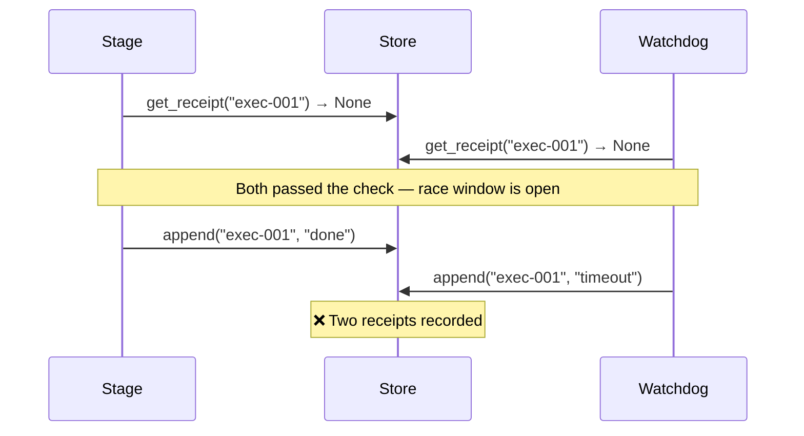

# receipt-race-demo

A minimal Python demonstration of a **check-then-act race condition** in an
exactly-once receipt-processing system, with a deterministic failing test,
an atomic fix, and automated CI.

---

## Problem description

A receipt records the terminal state of a processing execution — either
`done` (stage completion) or `timeout` (watchdog). The system must
guarantee that **exactly one** terminal receipt exists per `execution_id`.

## How the race condition occurs

The buggy `record_terminal()` performs two separate, unprotected steps:

```
1. CHECK  →  existing = get_receipt(execution_id)   # sees None
                      ↑ gap — no lock held ↑
2. ACT    →  _store.append((execution_id, state))   # writes receipt
```

If two threads (stage completion and watchdog) both execute the CHECK before
either executes the ACT, both see `None` and both proceed to write. The
result is two receipts for the same `execution_id`.



## Why sequential tests miss it

Sequential tests call `record_terminal()` from a single thread. The check
and the write execute in order with no opportunity for another thread to
interleave. The duplicate path is never exercised.

## How the deterministic test forces the interleaving

`test_duplicate_terminal_receipt_race` patches `get_receipt` to place a
`threading.Barrier(2)` immediately after the check returns `None`:

```
Thread A (stage)   →  get_receipt() → None  →  barrier.wait()  ─┐
Thread B (watchdog)→  get_receipt() → None  →  barrier.wait()  ─┘→ both released
Thread A           →  _store.append("done")
Thread B           →  _store.append("timeout")
                                                      ↑ two receipts: race proved
```

No `sleep()`, no random timing, no retry loops. The barrier fires once and
both threads proceed to the write in guaranteed order.

## The fix

`record_terminal()` acquires `_receipt_lock` before the check and releases
it after the write. Only one thread can execute the combined check-and-write
at a time. Any thread that loses the race sees the existing receipt during
the check and returns `False` without writing.

```python
with _receipt_lock:          # <-- lock acquired
    if get_receipt(execution_id) is not None:
        return False
    _store.append((execution_id, state))
    return True
```                           # <-- lock released

After the fix, the patched `get_receipt` barrier never fires for a second
thread (because the second thread blocks on the lock and sees the already-
written receipt), so the test correctly expects and finds exactly one receipt.

## Limitations

`_receipt_lock` is a **thread-level** lock. It coordinates threads that share
the same Python process and the same lock object.

It provides **no guarantee** across:

- Multiple OS processes running the same code.
- Distributed workers on different machines.
- Separate Python interpreters (even on the same machine).

For cross-process or distributed exactly-once guarantees, you need:

- A **database uniqueness constraint** (`UNIQUE` index + `INSERT OR IGNORE`,
  or optimistic locking with a CAS operation).
- A **distributed lock** (Redis `SET NX`, ZooKeeper, etcd, or a cloud
  equivalent such as DynamoDB conditional writes).
- A **transactional message queue** with exactly-once delivery semantics.

## Running tests locally

```bash
python -m venv .venv
source .venv/bin/activate   # Windows: .venv\Scripts\activate
pip install -r requirements.txt
pytest -v
```

Expected output (all 6 tests pass on the fixed implementation):

```
test_receipt_manager.py::test_duplicate_terminal_receipt_race PASSED
test_receipt_manager.py::test_stage_completion_wins PASSED
test_receipt_manager.py::test_watchdog_wins PASSED
test_receipt_manager.py::test_no_duplicate_after_terminal PASSED
test_receipt_manager.py::test_independent_executions PASSED
test_receipt_manager.py::test_no_receipt_before_recording PASSED
```

## CI workflow

`.github/workflows/tests.yml` runs on every push and pull request to `main`:

1. Checks out the repository.
2. Installs Python 3.12 and 3.13.
3. Installs dependencies from `requirements.txt`.
4. Runs `pytest -v --tb=short`.

The workflow fails if any test fails. The race-reproduction test acts as a
permanent regression guard: if `_receipt_lock` is ever removed, the
deterministic test fails immediately.

## Git history

| Commit | Message |
|--------|---------|
| `chore` | initialize receipt race demonstration |
| `test`  | reproduce duplicate terminal receipt race |
| `fix`   | make terminal receipt transitions atomic |
| `docs`  | document race reproduction and verification |

The `test` commit contains the failing concurrency test against the buggy
implementation. The `fix` commit introduces `_receipt_lock` and all tests
pass. The Git history is genuine and was not fabricated.
